# Paths sheets redesign: Trail (proposal)

Status: **build in progress: steps 1 to 6 built (PRs #1030, #1031 merged; step 6 in review); the phone check remains.** Written 2026-11-13. The owner was shown three layouts for the Android Paths sheets (Trail, Shelves, Deck) and chose **Trail** on 2026-11-13. This document is the build specification for it. The owner decided D1 to D5 on 2026-11-13 (section 11); the build is approved and goes in the order of section 9.

Scope: the Android client only, the two sheets `ArtistPathsSheet` (artist page) and `AlbumPathsSheet` (album page). One layout for every theme: no per-theme screens. No server change, no new request, no new colour.

## 1. What changes

Today a sheet is a chip row over a numbered list. A row shows a picture, a name and one line; the reason a step is on the path is only readable after opening its pane, which replaces the list.

Trail changes four things:

1. **The list is a trail.** A 2dp line runs down the left. Steps hang off it under a **link**: the person, label, work, place or record that connects them to the start. Steps that share a link sit under one link. The reason is readable before any tap.
2. **A step opens in place.** Tapping a step expands it inside the list with the content of today's pane. The separate pane, its Back button and its "Step n of N" footer with the up and down arrows are removed.
3. **The header shows the start.** The start's cover (album) or photo (artist) sits beside "Paths from" and the name.
4. **Tabs are words with a mark under the chosen one**, not filled chips, so the covers carry the colour.

What stays exactly as it is: the tabs and their order, the description line under them, one request per tab asked only when the tab is chosen, the answers kept in `PathsModel` / `AlbumPathsModel`, the loading, failure, empty and note texts, the long press that turns a cover, and every sentence the server sends.

## 2. Files

| File | What it is |
|---|---|
| [`design/paths-trail/tokens.css`](design/paths-trail/tokens.css) | Colour roles, mapped to `Palette` / `Ink`, with the codes of four reference palettes |
| [`design/paths-trail/trail.css`](design/paths-trail/trail.css) | Every component, with its sizes. 1 CSS px is 1 dp |
| [`design/paths-trail/mockups.html`](design/paths-trail/mockups.html) | All 12 tabs, closed and with a step open, with a palette switch. Open it in a browser |
| [`design/paths-trail/shots/`](design/paths-trail/shots/) | Stills of the mockups, used in section 7 |

The CSS is the specification of sizes and colours. The app is Jetpack Compose, so nothing is copied from it: build with the existing components named in section 9.

Two things in the mockups are not part of the design: the pictures are coloured placeholders with initials, and the chosen tab is drawn first in the tab row so it is visible in a still. In the app the tabs keep today's order and scroll.

Names, counts and sentences in the mockups are example data, not server output.

## 3. Anatomy and sizes

From top to bottom, inside the existing `ModalBottomSheet` (horizontal padding 16dp, as today):

| Part | Size and rule |
|---|---|
| Header | Picture 40dp (album: square, 4dp corners; artist: circle), 12dp gap, then the eyebrow "PATHS FROM" (`labelMedium`, 0.08em tracking, muted) over the name (`titleLarge`). The name keeps the `heading()` semantics. |
| Tabs | One scrolling row, 20dp between tabs, each at least 48dp tall. Unselected: `labelLarge`, muted. Selected: bold, text colour, a 3dp mark under it in `Ink.AccentText`. A 1dp rule in `Ink.Edge` runs under the whole row, edge to edge of the sheet. |
| Description | `bodyMedium`, muted. Text unchanged (`kindDescription`, `albumTabDescription`). |
| Trail | Indented 24dp. The line is 2dp wide in `Ink.Edge`, its centre 8dp from the content edge. It starts at the first link's dot and ends at the last step's elbow. 8dp between items; 12dp above a link that is not the first. |
| Link | A pill, not a button: 4dp by 12dp padding, full radius, ground `Ink.AccentDim`. The name in `labelLarge` weight 600 and the kind in weight 400, both in `Ink.Text` (muted text fails contrast on `accentDim` in Night). A 10dp dot in `Ink.Accent` sits on the line beside it, with a 3dp ring in the sheet's container colour. On a Brutal theme the dot also gets the theme's outline in `Ink.Edge`, because a pastel accent cannot be seen without it. |
| Step, closed | A row at least 64dp tall, the whole row one button. Picture 48dp, 12dp gap, name (`titleMedium`, 2 lines) over one line (`bodyMedium`, muted, 2 lines), then a small chevron pointing down (18dp, D3), muted. An 11dp by 2dp elbow in `Ink.Edge` joins the line to the row at the row's centre. No number. No divider between rows. |
| Step, open | The app's `Panel` on `Ink.Raised`, padding 12dp, 12dp between its parts. First a header row: picture 72dp, name (`titleLarge`), the lines today's pane shows beside its hero, and a chevron pointing up. Then the body of today's pane for that tab (section 7). Cards inside it sit on the sheet's ground so they read against the raised panel. On a Brutal theme the panel takes the theme's outline, radius and hard shadow, as `Panel` already does. |
| Notes | Under the trail, `bodySmall`, muted: the server's truncation, capped and history notes, unchanged. |

Type roles are the app's Material 3 roles, so each theme's font pair applies as it does everywhere else.

## 4. Colours

Trail adds no colour. Each part uses an existing `Palette` role, so all 29 themes are covered without a per-theme rule. The codes of four reference palettes, copied from `ui/theme/Palette.kt`:

| Used for | Role (`Ink`) | Day · Sand | Night | Soft Brut | Flow |
|---|---|---|---|---|---|
| Opened step, picture placeholders | `Raised` | `#E3D8C0` | `#252220` | `#F1EBDD` | `#EFECE5` |
| Cards inside an opened step (mockup sheet ground) | `Surface` | `#F8F1E1` | `#1C1A18` | `#FFFFFF` | `#FFFFFF` |
| Trail line, elbows, rule under the tabs, outlines | `Edge` | `#CFC2A6` | `#34302C` | `#1C1B22` | `#E2DFD6` |
| Names, sentences, link pill words, chosen tab | `Text` | `#26201A` | `#F4EFE6` | `#1C1B22` | `#15130F` |
| Second lines, description, eyebrows, notes, chevrons, other tabs | `TextMuted` | `#62563F` | `#B4AC9F` | `#5E5A6B` | `#645F55` |
| Link dot (a fill, never text) | `Accent` | `#AD4016` | `#F5D33F` | `#C4B5FD` | `#C2410C` |
| Link pill ground | `AccentDim` | `#EFC9B0` | `#554B26` | `#ECE6FF` | `#FBE4D5` |
| Mark under the chosen tab | `AccentText` | `#AD4016` | `#F5D33F` | `#1C1B22` | `#C2410C` |
| Failure message (unchanged) | `ChartRedText` | `#A8300E` | `#FF7B62` | `#B3261E` | `#C0271A` |

Shape: Classic themes use a 1dp outline in `Edge` and a 12dp radius on the opened step. Brutal themes use `Palette.shape` (Soft Brut: radius 10, outline 1.5, shadow 3 in `#1C1B22`).

The sheet keeps the container colour `ModalBottomSheet` already gives it per theme. The ring around a link dot must use that same colour, not `Surface`, where the two differ.

The same tab on three other palettes:

| Night | Soft Brut | Flow |
|---|---|---|
| 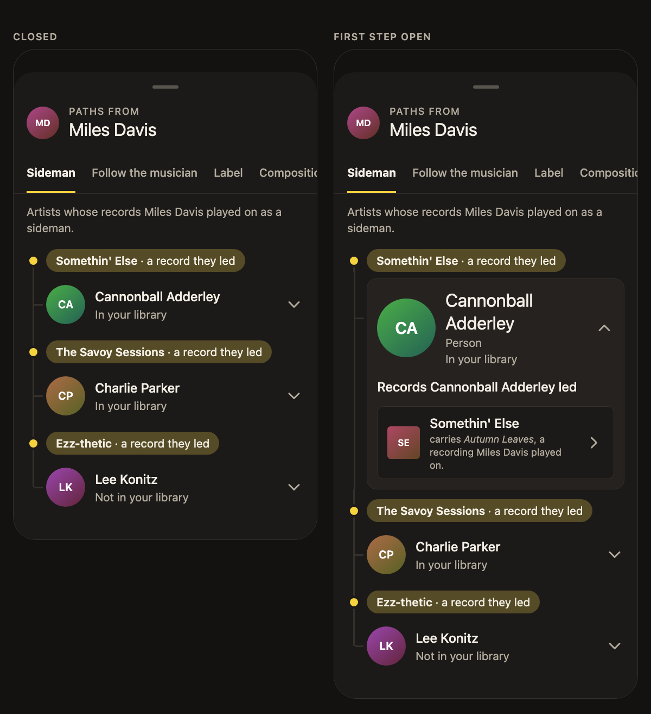 | 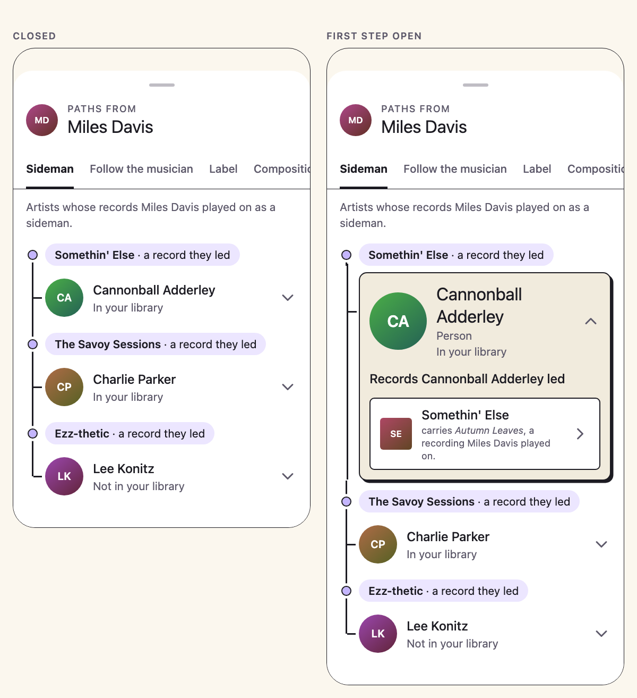 | 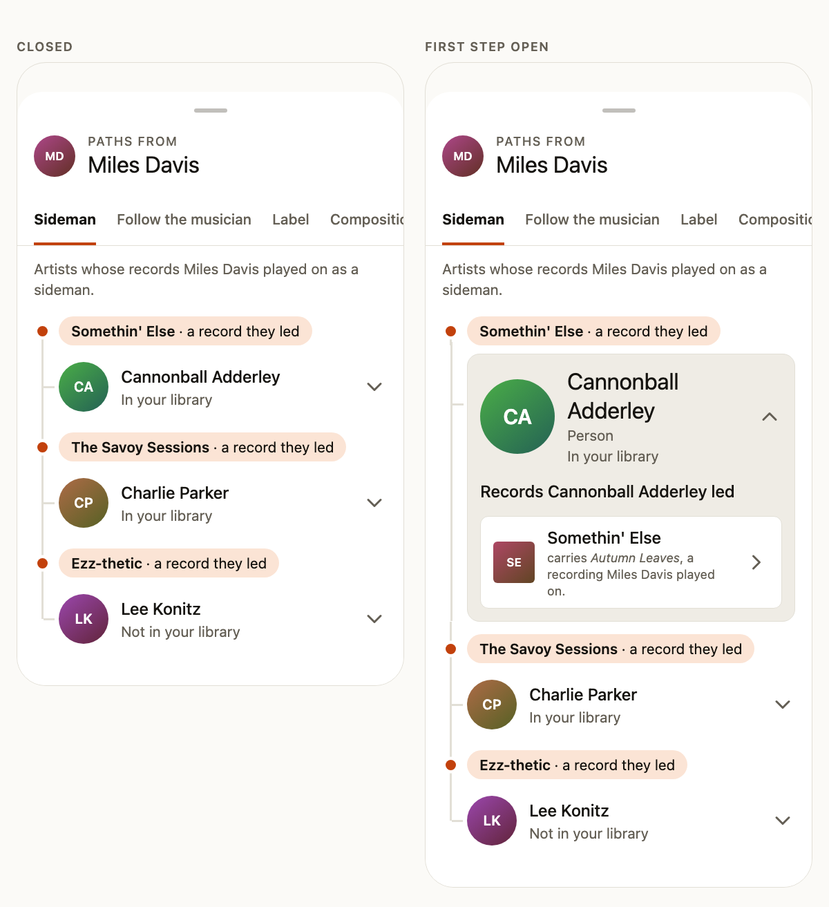 |

## 5. Links and grouping

A link is built from the step's **first** reason, so the list is stable. (Today the artist pane picks a reason at random each time it opens; the opened step may keep doing that for its body, but the link above it does not change.)

Grouping rule: steps with the same link text and kind form one group. Groups appear in the order of their first step in the server's answer; steps keep the server's order inside a group. This can move a step up to join its group (decision D1).

A step whose first reason names nothing to link through goes under a link that shows the kind alone (for example "Production credit").

### Album sheet (`AlbumTab`, from `AlbumStep.reasons.first()`)

| Tab | Link name | Link kind | Closed row, second line |
|---|---|---|---|
| Studio crew | `via.name` (the person) | the role of the credit on the start, from the reason's evidence (`producer`, `engineer`, `mix`, `mastering`): "producer credit", "engineer credit", "mixing credit", "mastering credit"; "production credit" when the evidence has none (D5) | artist |
| Guest list | `via.name` (the guest) | "guest credit" | artist |
| Covers and sources | `via.name` (the work) | "same work" or "related work" | artist |
| Same year, same scene | `via.name` (label, area or artist) | "same label", "same area" or "shared artist" | artist |
| Same room | `via.name` (studio or event) | "recorded at" | artist |
| Listen-through gaps | `via.name` | `reasonEyebrow(code)` in lower case | artist · the server's play label |
| Neighbours by ear | "`matchCount` of `seeds` tracks" ("N tracks" when seeds is 0) | "sound alike" | artist · year, when sent |

Today the second line of an album row is "artist · via". The via moves to the link, so the row keeps the artist only.

### Artist sheet (`PathKind`, from `PathStop.reasons.first()`)

| Tab | Link name | Link kind | Closed row, second line |
|---|---|---|---|
| Follow the musician | the musician that reason names (the field `PathPane.Song.musician` is built from) | "musician" | album · album artist, as today |
| Sideman | `via.name` when `via.type == "release"` (the record) | "a record they led" | "In your library" or "Not in your library" |
| Label | the label (`PathLabelReason.label`) | "same label" or "related label" | album artist |
| Composition | the work (`PathPane.Recording.work`) | "composed by {artist}" or "related work" | performer · album, as today |
| Scene | `via.name` (the place) | "same place" | "In your library" or "Not in your library" |

Sideman and Scene rows today say "Led X" and "From X". Both would repeat the link, so the line becomes the library state.

## 6. Behaviour

- **Open and close.** Tapping a closed step opens it. Tapping the header row of the open step closes it. One step is open at a time: opening another closes the first.
- **Scroll.** When a step opens, the list scrolls so its header row is in view. Each tab keeps its own scroll position, as today.
- **Back.** Back with a step open closes the step. Back with none open closes the sheet. This replaces today's Back from the pane.
- **Leaving and returning.** Unchanged: opening an album or artist from an opened step leaves the page, and Back returns to the sheet on the same tab with the same step open. The saved `step` stays an index into the server's list, not into the grouped order.
- **Changing tab** closes the open step, as today (`step = -1`).
- **Long press** on a closed row still turns the cover to the album's next alternate cover.
- **Motion.** The step grows and shrinks with the app's standard duration from `ui/theme/Motion.kt`; with reduced motion it switches at once.
- **TalkBack.** A link is a heading and is read as "name, kind". A step row is a button with the state "expanded" or "collapsed" and the click label "Open step" or "Close step". "Show next cover" stays a custom action. The line, dots, elbows and chevrons are decoration with no description. Every target is at least 48dp.
- **Loading, failure, empty.** Unchanged, in the space under the description: the spinner, the message with Try again (and the update request on 404), and the empty line.

## 7. Every tab, closed and open

Left: the list. Right: the first step opened. The opened body is today's pane content for that tab; only its header row is new.

### Album Paths

**Studio crew.** Open: the reason card (eyebrow from the code, then the person), the server's sentence, then the person and the album to open (`FindRow`).

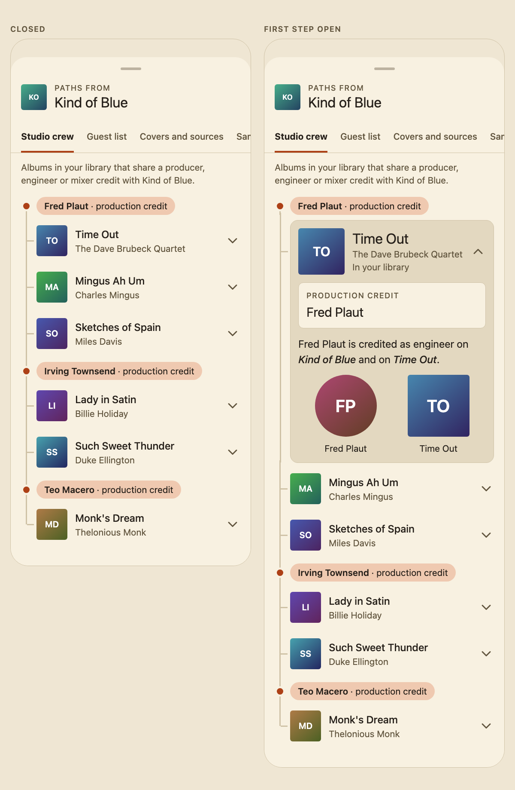

**Guest list.** Open: as Studio crew, with the guest.

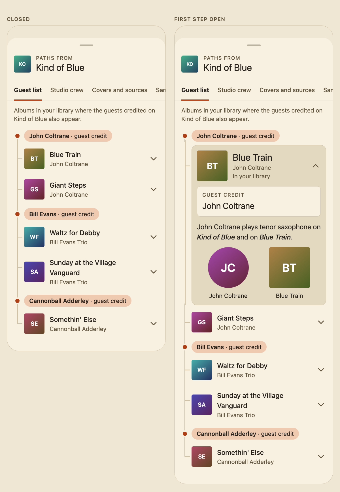

**Covers and sources.** Open: the work as the reason card, the sentence, the album to open. The same work can head two links when one is "same work" and the other "related work".

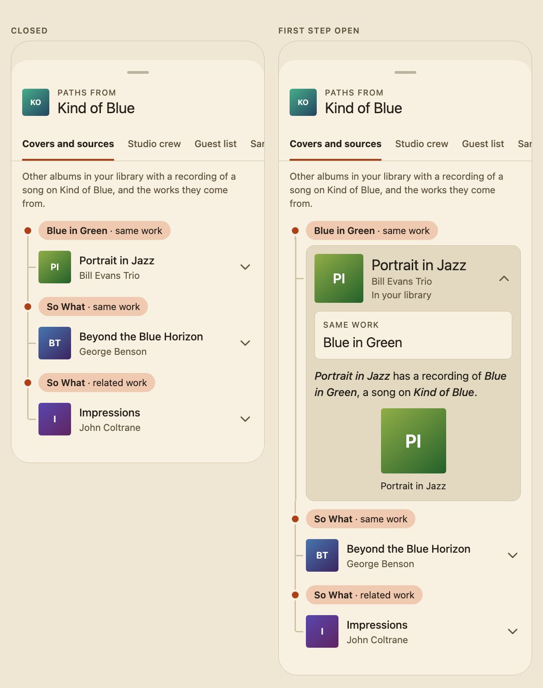

**Same year, same scene.** Open: the link and the period side by side (today's two cards; the period card only when `yearGap` finds it), the sentence, the album.

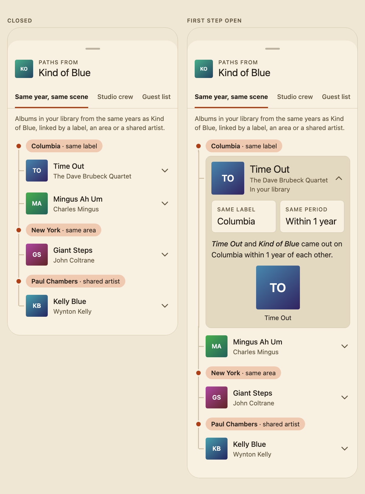

**Same room.** Open: the two albums side by side (`SameRoomPhotos`), the place as the reason card, the sentence, the album.

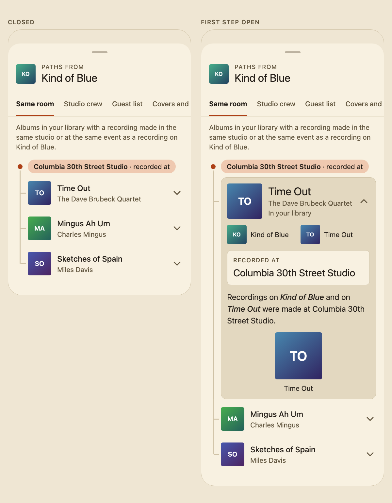

**Listen-through gaps.** Closed rows carry the play label. Open: the "Your listening" card first, then the reason card, the sentence, the person and the album. The history notes stay under the trail.

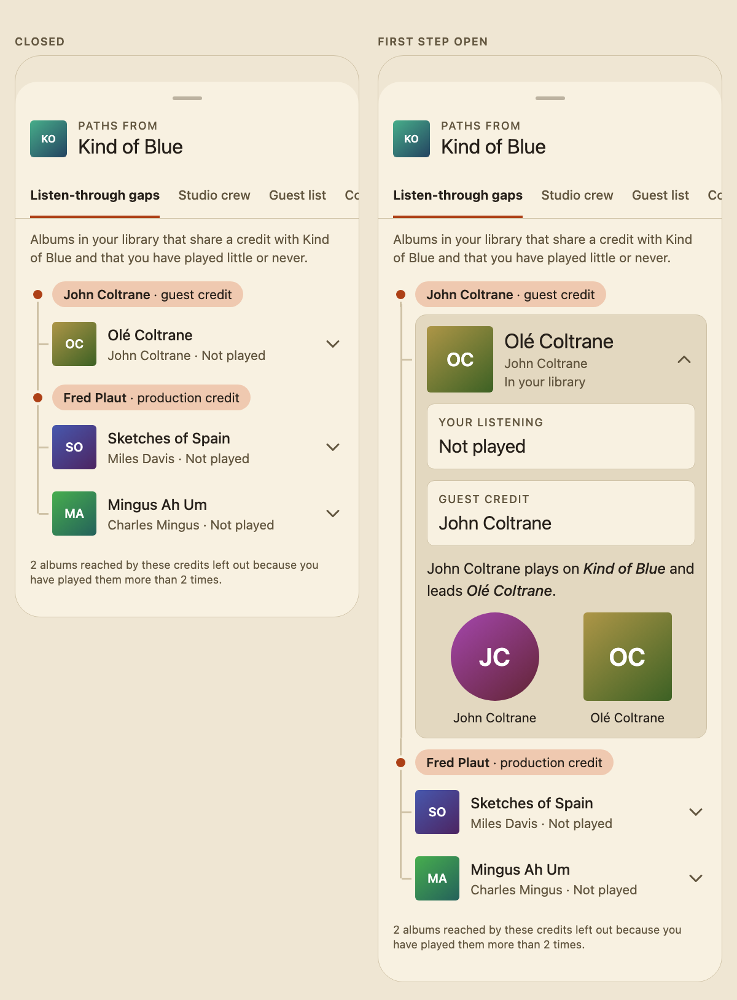

**Neighbours by ear** (offered only when the server reports sonic similarity). Links are the matched track counts, the only measure shown; `similarity` is still never read. Open: the "Sounds alike" card, the sentence when sent, the album.

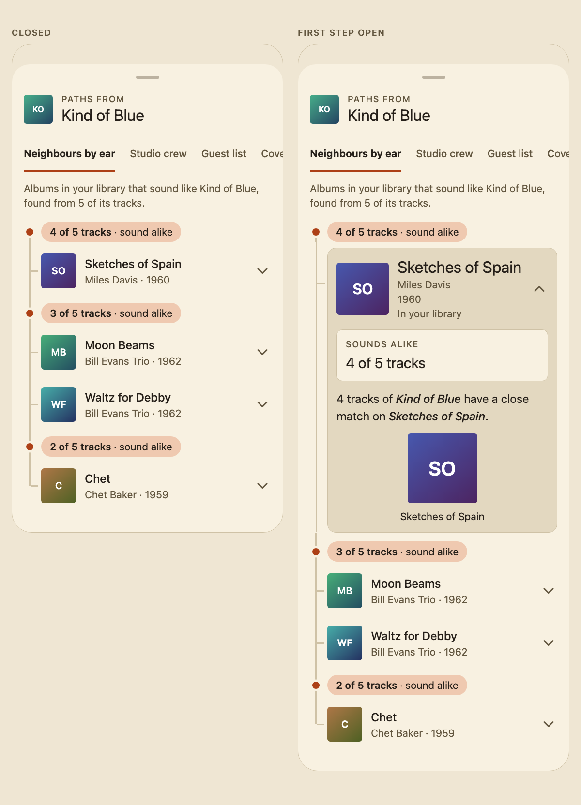

### Artist Paths

**Follow the musician.** Steps are songs. Open: the song with "on album", "by artist" and the library line, the story sentence, then the musician and the album (`SongPane`).

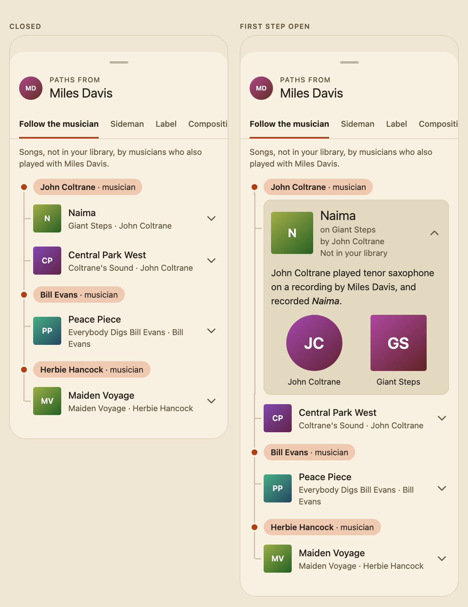

**Sideman.** Steps are artists, so pictures are circles. Open: the leader, then "Records {name} led" with one button per record (`LeaderPane`). The header's picture and name open the leader's page; the chevron closes the step (decision D3 covers the split).

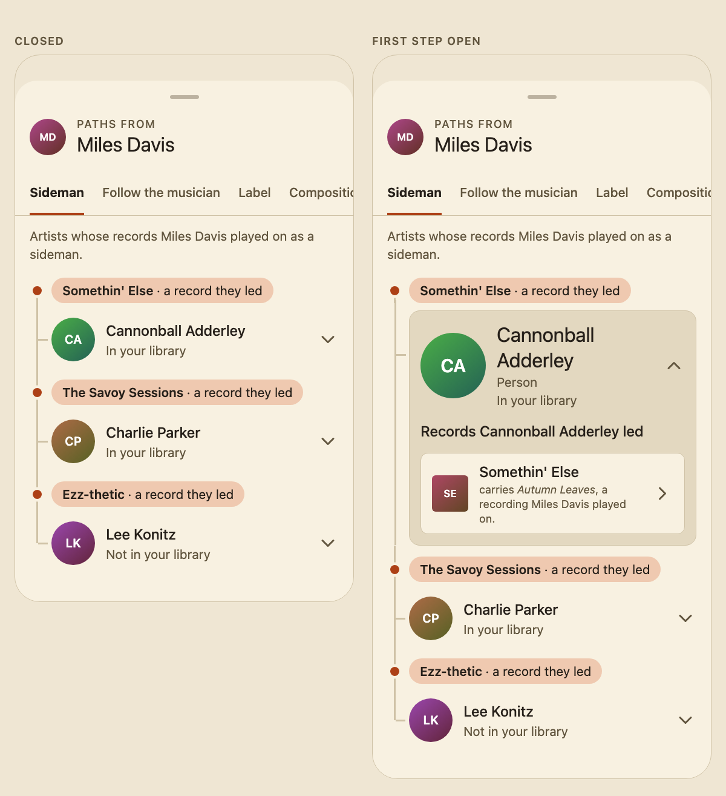

**Label.** Open: the label card with "Same label as:" and the owner's album, then the artist and the album (`LabelPane`).

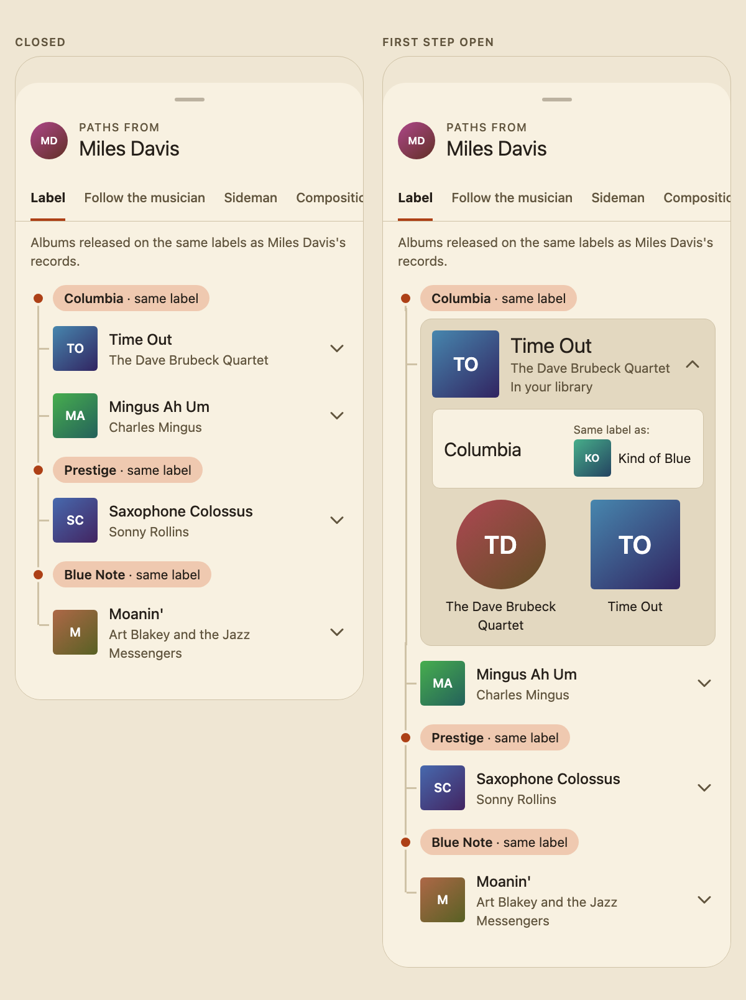

**Composition.** Open: the work card with the owner's recording, the "also recorded" sentence, then the performer and the album (`RecordingPane`).

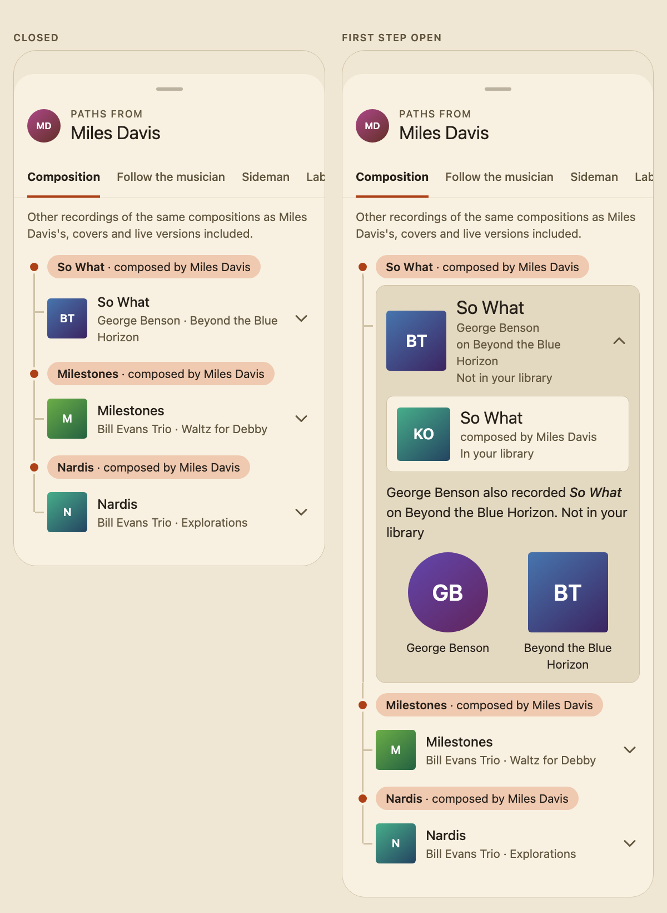

**Scene.** Steps are artists. Open: Same place and Same era side by side, the sentence, the artist to open (`PlacePane`). When the place, anchor or era is missing, the server's sentence alone, as today.

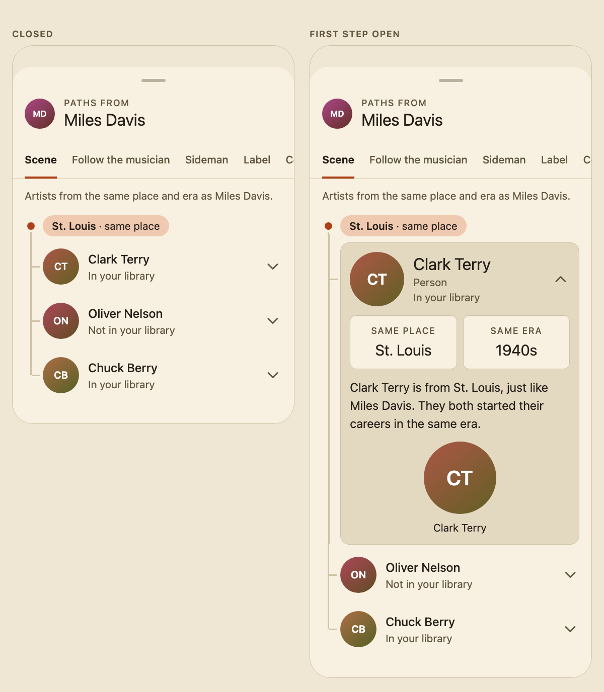

## 8. What is removed

- `PathDetail` and `AlbumPathDetail`: the separate pane, its Back button, the rule above its footer (and the Soft Brut exception for that rule), the "Step n of N" text and the previous and next arrows.
- The step number at the start of a row, the row's right chevron and `RowDivider` between rows.
- `FilterChip` in these two sheets only. The component itself stays for its other uses.

## 9. Build map

All paths are under `android/app/src/main/kotlin/app/discair/`.

| Piece | Where | Notes |
|---|---|---|
| Link and grouping (merged, PR 1030) | new `model/PathTrail.kt` | Pure functions: the link (name, kind) of a `PathStop` per `PathKind` and of an `AlbumStep` per `AlbumTab`, and the grouping of a list by link. No Compose, so it is unit-tested directly. |
| Trail pieces (merged, PR 1030) | new `ui/common/PathTrail.kt` | Header, tab row, link pill, closed row, the opened-step frame, and the line drawn per item (`drawBehind`), shared by both sheets. |
| Artist sheet | `ui/artist/ArtistPaths.kt` | `PathList` renders groups; `PathRow` becomes the closed row; `PathDetail` is deleted; `rowDetail` changes for Sideman and Scene. |
| Artist bodies | `ui/artist/PathPanes.kt` | `PaneBody` and the five panes are reused inside the opened step. Their hero rows move to the shared header row at 72dp. |
| Album sheet | `ui/album/AlbumPathsSheet.kt` | Same changes; `AlbumPaneBody` and `ReasonCard` are reused; `AlbumPathDetail` is deleted. |
| Album second line | `model/AlbumPathSteps.kt` | `AlbumStep.detail` drops the via (and the track count for Neighbours by ear, which moves to the link). |

Reused as they are: `ModalBottomSheet`, `Panel` / `InfoCard`, `Eyebrow`, `FindRow`, `LinkTile`, `SameRoomPhotos`, `PathRowCover`, `PathAlbumCover`, `ArtistPhoto`, `CandidateCover`, `PathTile`, `LibraryLine`.

## 10. Tests and checks

Follow `docs/TEST_PLAN.md` and `docs/DEVELOPMENT_WORKFLOW.md`. At the least:

- A new `PathTrailTest`: the link of each tab from a fixture step, the fallback when the first reason has no via, grouping order (first appearance, server order inside), and that a saved step index still finds its step after grouping.
- `PathsTest` and `AlbumPathStepsTest` updated for the changed second lines.
- The shared palette contrast test extended, or a new case added, for `Text` on `AccentDim` (the link pill) across all palettes.
- On the owner's phone: every tab of both sheets on one Classic light, one Classic dark, one Brutal theme, Soft Brut and Flow; Back from an opened album or artist; TalkBack through one tab; reduced motion.

## 11. Decisions

Decided by the owner on 2026-11-13.

| # | Decision | Outcome |
|---|---|---|
| D1 | Grouping can move a step up to join its link. | **Group by first appearance**, as recommended. |
| D2 | Text tabs with a mark replace `FilterChip` on every theme, including the Brutal ones. | **Text tabs everywhere**, as recommended; revisit after the phone check if a Brutal theme reads as too plain. |
| D3 | A chevron on each row (down when closed, up when open). | **Keep it, but small** (18dp instead of 24dp). |
| D4 | The link pill could open the person, label or work it names. | **Not a button**, as recommended. |
| D5 | Studio crew links could show the role instead of "production credit". | **Show the role.** The server already carries it: every album reason sends `evidence` whose first entry is the credit on the start, with its `relation` (`producer`, `engineer`, `mix`, `mastering`), and the client already reads it into `PathReason.credits`; only `AlbumStepReason` dropped it. So no server change is needed; the client keeps `credits` on `AlbumStepReason`. |

## 12. Out of scope

The sonic path sheet in the player (`SonicPathSheet`), the macOS and web clients, the server, the wording of any sentence or description, and any change to when the server is asked.
